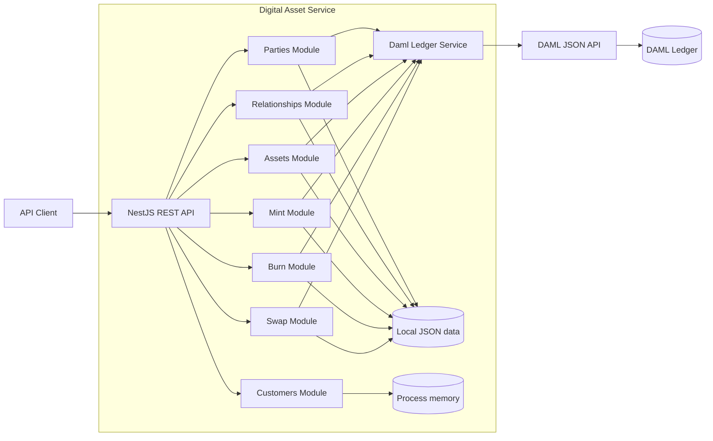

## Overview

This project is a prototype foundation for managing tokenized deposits: digital tokens intended to represent deposit value issued and administered by a financial institution. It models the on-ledger asset and the operational controls around it, including participant registration, issuer and holder permissions, mint requests for issuance, burn requests for redemption, and controlled asset swaps. DAML contracts provide ledger-side authorization and state checks, while the REST API exposes these workflows to client applications.

The current codebase implements token and workflow management, not a complete banking or payment system. It does not connect to deposit accounts or payment rails, verify that tokens are backed by off-ledger funds, or perform bank-ledger reconciliation. Those integrations and controls would need to be added before using the system for real deposits or production financial operations.

## Technology

- Node.js, TypeScript, and NestJS 11
- DAML SDK 2.10.4 for ledger contracts
- JSON files in `data/` for local application state
- Jest for unit and end-to-end tests

## Capabilities

- Register and activate/deactivate participant parties
- Maintain party relationships and asset issuer/holder whitelists
- Create and enable/disable assets
- Submit, approve, and cancel mint and burn requests
- Propose, accept, lock, settle, cancel, or abort swaps
- Create in-memory customer records
- Track DAML sync status and contract IDs alongside locally persisted domain records where applicable

## High-Level Design



### Request and data flow

1. A client sends an HTTP request to a NestJS controller.
2. The feature module's service validates and applies the domain operation, then stores supported records in a JSON file under `data/`.
3. When DAML integration is enabled, the service calls `DamlService`, which communicates with the configured DAML JSON API and records relevant contract IDs or sync status.
4. DAML contracts enforce ledger-side rules such as asset enablement, permissions, pause state, and swap lock/settlement conditions.

The JSON files are application-side persistence and are not a substitute for ledger state. Customers currently exist only in process memory. This storage model is intended for a development/prototype environment, not concurrent or horizontally scaled production deployments.

## Project Layout

```text
src/
	assets/          Asset registration and enable/disable API
	burn/            Burn request workflow
	customers/       Basic in-memory customer endpoint
	daml/            DAML JSON API integration service
	mint/            Mint request workflow
	parties/         Participant party management
	relationships/   Relationships and asset whitelisting
	swap/            Swap request and settlement workflow
daml/
	Asset/           Asset, holding, mint, and burn contracts
	Common/          Registry and governance contracts
	Flow/            Swap request, escrow, and settlement contracts
data/               Local JSON persistence files
test/               End-to-end tests
```

## Requirements and Setup

- Node.js and npm
- DAML SDK 2.10.4 only if you need to build or run the DAML contracts
- A running DAML JSON API only if you want ledger synchronization

Install dependencies and start the API in watch mode:

```bash
npm install
npm run start:dev
```

The API listens on port `3000` by default. Set `PORT` to use another port. Build and run the compiled API with:

```bash
npm run build
npm run start:prod
```

Build the DAML package from the repository root with:

```bash
daml build
```

The DAML ledger and JSON API are separate services; configure and start them using your DAML environment's deployment setup.

## Configuration

DAML integration is disabled unless `DAML_ENABLED=true` and `DAML_JSON_API_URL` is set. Without it, the API uses its local persistence paths and DAML sync is skipped where supported.

| Variable | Purpose | Default / requirement |
| --- | --- | --- |
| `PORT` | HTTP listen port | `3000` |
| `DAML_ENABLED` | Enable ledger synchronization | Must be `true` |
| `DAML_JSON_API_URL` | Base URL for DAML JSON API | Required when enabled, e.g. `http://localhost:7575` |
| `DAML_ADMIN_PARTY` | Admin party used for participant synchronization and related operations | Required by operations that need the admin party |
| `DAML_JSON_API_TOKEN` | Bearer token for DAML JSON API requests | Optional when the API accepts unauthenticated requests |
| `DAML_JWT_SECRET` | Secret used to generate short-lived party-scoped JWTs | Optional; depends on ledger authentication setup |
| `DAML_LEDGER_ID` | Ledger ID in generated JWT claims | `sandbox` |
| `DAML_APPLICATION_ID` | Application ID in generated JWT claims | `digitalAsset` |
| `DAML_REQUEST_TIMEOUT_MS` | DAML request timeout in milliseconds | `5000` in code |
| `DAML_PACKAGE_ID` | DAML package ID override | Optional |
| `DAML_PARTICIPANT`, `DAML_KYC_APPLICATION`, `DAML_ASSET_DIRECTORY`, `DAML_ASSET_PERMISSION`, `DAML_ADMIN_ROLE`, `DAML_PAUSE_SWITCH`, `DAML_MINT_REQUEST`, `DAML_BURN_REQUEST`, `DAML_SWAP_REQUEST`, `DAML_SWAP_ESCROW` | Override DAML template identifiers | Defaults are defined in `src/daml/daml-ledger.service.ts` |

Set these in the process environment or a local `.env` file. Do not commit secrets or live ledger credentials.

## REST API

All routes are relative to the API origin (for example, `http://localhost:3000`). Request and response fields are defined by the DTOs and types in each feature folder.

| Feature | Method | Route | Operation |
| --- | --- | --- | --- |
| Parties | `POST` | `/parties/parties` | Create party |
| Parties | `GET` | `/parties/parties` | List parties |
| Parties | `GET` | `/parties/parties/:id` | Get party |
| Parties | `POST` | `/parties/parties/activate` | Activate party |
| Parties | `POST` | `/parties/parties/deactivate` | Deactivate party |
| Relationships | `POST` | `/relationships` | Create relationship |
| Relationships | `GET` | `/relationships` | List relationships |
| Relationships | `POST` | `/relationships/whitelist` | Add issuer/holder permission |
| Relationships | `DELETE` | `/relationships/whitelist` | Revoke issuer/holder permission |
| Assets | `POST` | `/assets` | Create asset |
| Assets | `GET` | `/assets` | List assets |
| Assets | `POST` | `/assets/enable` | Enable asset |
| Assets | `POST` | `/assets/disable` | Disable asset |
| Mint | `POST` | `/mint` | Create mint request |
| Mint | `GET` | `/mint` | List requests; optional `adminPartyId` and `assetId` query filters |
| Mint | `POST` | `/mint/approve` | Approve mint request |
| Mint | `POST` | `/mint/cancel` | Cancel mint request |
| Burn | `POST` | `/burn` | Create burn request |
| Burn | `GET` | `/burn` | List requests; optional `adminPartyId` and `assetId` query filters |
| Burn | `POST` | `/burn/approve` | Approve burn request |
| Burn | `POST` | `/burn/cancel` | Cancel burn request |
| Swap | `POST` | `/swap` | Create swap request |
| Swap | `GET` | `/swap` | List swap requests |
| Swap | `POST` | `/swap/accept` | Accept swap request |
| Swap | `POST` | `/swap/cancel` | Cancel swap request |
| Swap | `POST` | `/swap/lock-leg-a` | Lock swap leg A |
| Swap | `POST` | `/swap/lock-leg-b` | Lock swap leg B |
| Swap | `POST` | `/swap/settle` | Settle both legs atomically |
| Swap | `POST` | `/swap/abort` | Abort swap and return locks |
| Customers | `POST` | `/customers` | Create in-memory customer |

**Route note:** Party controller methods currently include a second `parties` path segment beneath the `/parties` controller prefix, so the routes above intentionally show `/parties/parties...` as implemented.

## DAML Model

- `Common.Registry` contains participant, KYC, asset directory, and asset permission contracts.
- `Common.Governance` contains admin-role and pause-switch contracts.
- `Asset.Standard` defines assets, holdings, transfers, mint requests, burn requests, and swap locks.
- `Flow.Swap` defines swap proposals, escrow, leg locking, atomic settlement, and abort flows.

The DAML contracts are the ledger-side source of truth for ledger operations and enforce authorization and state invariants. The REST layer provides orchestration and local request tracking.

## Tests

```bash
npm test
npm run test:e2e
npm run test:cov
```

